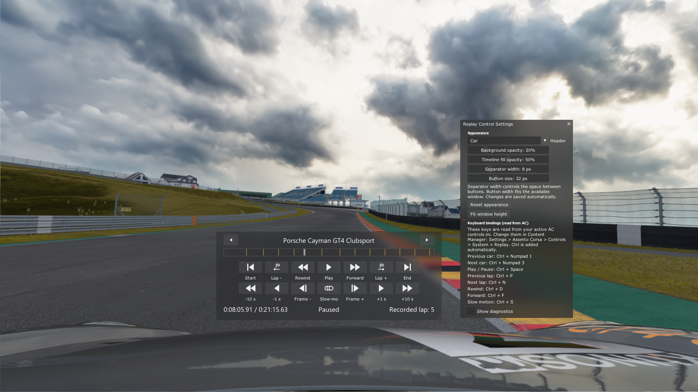

# Replay Control 0.1.38

A compact replay controller for Assetto Corsa with Custom Shaders Patch 0.2.11.

[Download Replay Control 0.1.38](https://github.com/GunnarFrei/AC-Replay-Control/releases/download/v0.1.38/ReplayControl-0.1.38.zip)

## Install or update
Copy the entire ReplayControl folder, including icons, into:

    <Assetto Corsa>/apps/lua/

Replace the app files and reload the app. AC normally does not need restarting.
Saved appearance settings are stored separately by CSP and survive updates.

## Required keyboard bindings
In Content Manager, open:

    Settings > Assetto Corsa > Controls > System > Replay

Assign keyboard keys for Previous car, Next car, Pause replay, Previous lap,
Next lap, Rewind, Fast-forward and Slow motion. The app reads those main keys
from your active AC controls.ini and adds the fixed Ctrl modifier. Controller-only
assignments are not sufficient for the app to send native replay commands.
AC must be in the foreground. Settings shows the bindings actually read from AC.

## Controls
The header shows the selected car/driver/team information. Arrows at its sides
switch to the previous or next car.

Top row: Start, Lap -, Rewind, Play/Pause, Forward, Lap +, End.
Second row: -10 s, -1 s, Frame -, Slow-mo, Frame +, +1 s, +10 s.

- Play returns paused, fast, reverse or slow playback to normal speed (1x).
- At normal speed, the same button becomes Pause.
- Frame steps pause the replay and move one recorded replay frame, which is
  not necessarily one rendered video frame.
- The timeline spans the full content width. Drag it to seek.
- Time is shown as H:MM:SS.cc (hundredths of a second).
- Time, playback status and recorded lap share a single aligned row.
- Normal car switching and scrubbing do not display status reports.

Native playback and speed changes follow AC's own behavior, including its audio.

## Lap markers and other cars
Gold ticks are observed lap starts for the focused car. The app learns them
while you play or scrub through the recording and caches them per car.
It does not preload lap starts from parts of the replay you have not visited.
Closing/unloading the app clears this marker cache.

For the recording car (index 0), Lap -/+ use AC's native lap commands. For other
cars they jump between the already observed lap starts. If no target is known,
play or scrub through more of the replay first. AC can report a completed-lap
counter of zero for other replay cars. The app then shows Recorded lap: --
rather than claiming the lap is 1. Marker accuracy depends on replay telemetry;
nearby observations within 750 ms are treated as the same start.

## Settings
Open the app window's Settings menu.

| Setting | Meaning | Default |
| --- | --- | --- |
| Header | Car, Driver, Team, or Team + driver | Team + driver |
| Background opacity | 0% invisible, 100% opaque | 20% |
| Timeline fill opacity | 0% invisible, 100% opaque | 50% |
| Separator width | Space between buttons | 8 px |
| Button size | Button/icon height | 32 px |

Button width and spacing adapt to keep both seven-button rows inside the window.
Team + driver falls back to the available name if team information is absent.
Reset appearance restores all five appearance settings. Fit window height
removes unused vertical space without changing the width.

Settings save automatically through CSP's ac.storage(). On a standard install
this is under Documents/Assetto Corsa/cfg/extension/state/lua/app/ReplayControl.ini.
Earlier transparency settings are converted once to opacity without changing
the visual appearance.

Keyboard bindings are read-only here; change them in Content Manager.
Show diagnostics is optional and disabled by default. It displays only useful
replay/car telemetry and the last relevant message. No debug files are written.

## Validation and limitations
Version 0.1.38 passed 25 behavioral checks using Lua 5.1 with simulated CSP APIs:
input sequencing/release, playback controls, frame steps, focused-car marker
caches, seeking, settings migration, UI paths and style-stack balancing.
Manifest callbacks, SDK references and PNG resources were checked separately.
These checks do not replace the game's input handling or visual rendering.
The existing app was tested interactively during development; the final cleanup
and the frame-step change from fast playback still need an in-game check.
